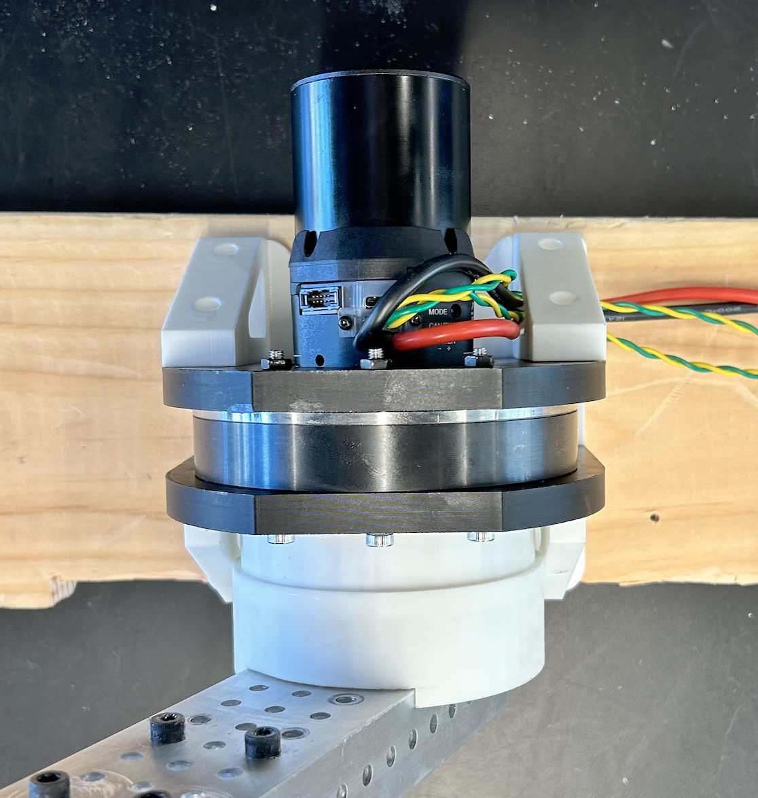
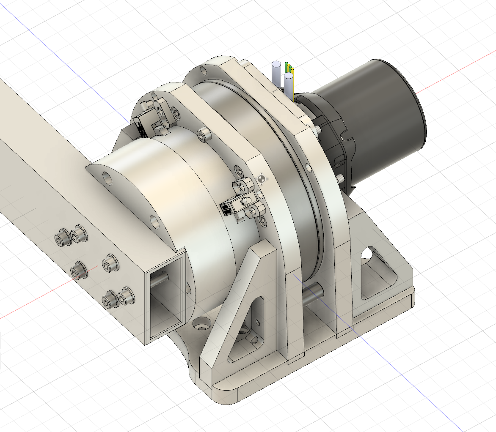
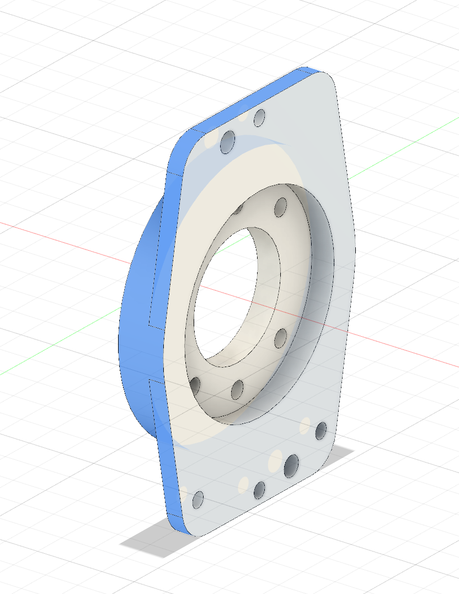
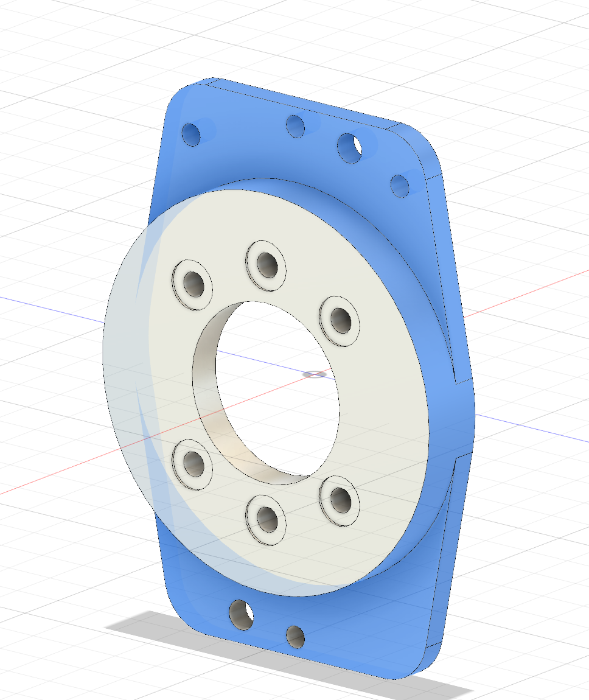

# frc114-harmonic-drive

[](./LICENSE)
[**🔎 Search (filename)**](https://github.com/OAK-WJR/frc114-harmonic-drive/find/main) · [**📘 Docs**](http://34.61.86.245/docs/)

> Built for FRC robotics: a modular library of **harmonic reducers**, motor-board **adapters**, and **universal joints** (vertical).  
> Repository accepts **`.step` only** (mm, Z↑). *(Legacy non-STEP files will be migrated.)*

<p align="center">
  
  
</p>

---

## Def

 - **Adapter** = the **motor-side connection module**.
  It includes the motor interface (mounting holes, pilot, flange) and ensures that a specific motor (NEO, Kraken, Falcon, etc.) can be mounted to the reducer. Some adapters may integrate the motor directly, or use a flange plate plus connector set.

- **Joint** = the whole system of reduction, inculde support structures, harmonic reducers, Adapter, output...

- **AJI (Adapter–Joint Interface)** = the **fixed interface standard** between adapter and joint.
  Geometry is frozen (pilot, bolt circle, holes, thickness, datum, etc.), so every adapter in a series (e.g., D25) mates with every joint of the same series.

## Why this repo

- **Using harmonic drive** :
  - No backlash **(Accuracy ≤ 1 arc-min = 0.0167° = 0.0002914 rad)**
  - Light **(D Series All < 1kg, D17 Even 0.41kg)**
  - Big Gear Ratio **(100 : 1)**
  - Flexible Size **(Diameter: 8cm ~ 14.2cm, Depth: 1.85cm ~ 2.79cm)**
  - Heavy load **(Average ~90Nm (can hold about 9kg at 1.0meter at most), biggest <892Nm (can hold 90.9kg at 1.0meter at most)**
- **One interface per model**: For each reducer size (like D25), all adapters (the motor-mounting plates) and all joints (the universal connectors, vertical or parallel) are designed around the same Adapter–Joint Interface (AJI).
This means any D25 adapter can mate with any D25 joint, without redesign.
- **Swap-friendly**: change motors or joints **without** re-drawing the opposite side.  
- **Consistent exports**: only `.step` files to maximize CAD interoperability.

---

## Quick access

- **Browse by directory**
  - Reducers: [`mechanical/base_reducers/`](https://github.com/OAK-WJR/frc114-harmonic-drive/tree/main/mechanical/base_reducers)
  - Adapters: [`D17`](https://github.com/OAK-WJR/frc114-harmonic-drive/tree/main/mechanical/adapters/D17) · [`D20`](https://github.com/OAK-WJR/frc114-harmonic-drive/tree/main/mechanical/adapters/D20) · [`D25`](https://github.com/OAK-WJR/frc114-harmonic-drive/tree/main/mechanical/adapters/D25) · [`J32`](https://github.com/OAK-WJR/frc114-harmonic-drive/tree/main/mechanical/adapters/J32)
  - Joints: [`mechanical/joints/`](https://github.com/OAK-WJR/frc114-harmonic-drive/tree/main/mechanical/joints)
- **Filename search** (works for binaries):  
  → https://github.com/OAK-WJR/frc114-harmonic-drive/find/main  
  Try: `D25-vertical` · `NEOVertex` · `KrakenX60`

---

## What’s inside

```text
mechanical/
  base_reducers/                # reducers only (.step)
  adapters/                     # <Series>/<...MOTOR...>.step
  joints/                       # <Series>-vertical.step
docs/
  design-example/
    D25-MotorBoardAdapter_example-design_reference.step
    pictures/                   # images used in README
  real-pictures/                # real assembly photos
LICENSE
```

**Supported models (now)**: `D17 · D20 · D25 · J32`  
**Example**: `mechanical/joints/D25-vertical.step`

---

## Naming (short)

- **Reducers**: `<Series><Frame>[-<Ratio>].step` → `D25-24.step`, `J32.step`  
- **Adapters**: `adapters/<Series>/<Series>-<MOTOR>-<vN>[-<Mount>].step`  
  - `MOTOR` UPPERCASE recommended: `NEOVERTEX | KRAKENX60 | ...`  
  - `vN`: `v1/v2/v5...`; `Mount` (optional): `P | NT | NF`  
- **Joints**: `joints/<Series>-vertical.step`

Full rules → **Docs**: http://34.61.86.245/docs/usage.html

---

## Contributing / Requirements

1. Export **`.step`** only (mm, Z↑).  
2. Follow naming & folder layout above.  
3. Verify AJI fit with **all** opposite-side parts of the same model.  
4. (Optional) update `config/variants.csv`.  
5. Submit PR with 1–2 screenshots.

<p align="center">
  
  
</p>
<p align="center"><i>Blue area = AJI mating & datum zone (FROZEN · do not modify).</i></p>

---

## License & attribution

© 2025 Jiarui Wu — Licensed under **CERN-OHL-S v2.0** (see `LICENSE`).  
Vendor “reference-only” models are **not** redistributed; use vendor links locally.


