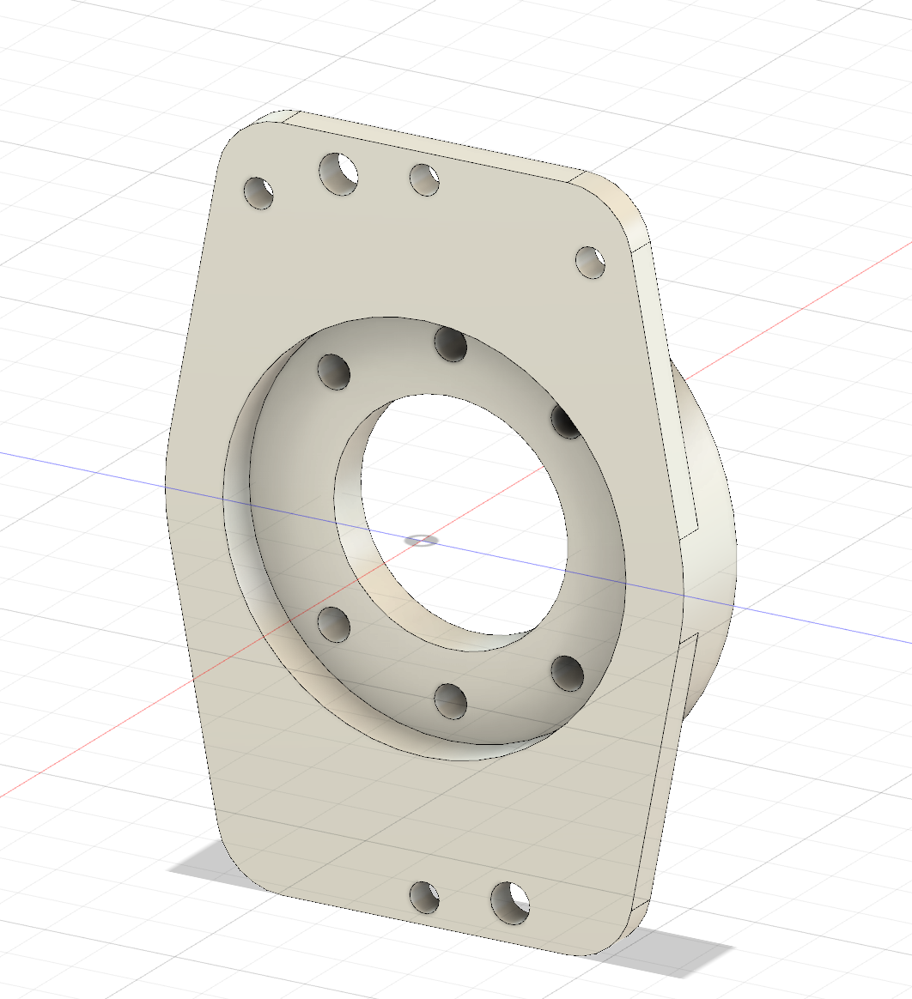

# frc114-harmonic-drive

[](./LICENSE)
[](http://34.61.86.245/docs/) <!-- optional if you later host an svg -->
[**🔎 Search models**](http://34.61.86.245/docs/search.html) · [**📘 Docs**](http://34.61.86.245/docs/) · [中文 / Chinese](./README.zh-CN.md)

> Built for FRC robotics: a modular library of **harmonic reducers**, motor-board **adapters**, and **universal joints** (vertical/parallel).  
> Repository accepts **`.step` only** (mm, Z↑).

<p align="center">
  
  
</p>

---

## Why this repo

- **Single interface per model** (e.g., **D25**): every adapter ↔ every joint mate through the same **AJI (Adapter–Joint Interface)**.  
- **Swap-friendly**: change motors or joints **without** re-drawing the opposite side.  
- **Consistent exports**: only `.step` files to maximize CAD interoperability.

---

## Quick search

- Series: [D17](https://github.com/OAK-WJR/frc114-harmonic-drive/search?q=path%3Amechanical%2F+D17&type=code) · [D20](https://github.com/OAK-WJR/frc114-harmonic-drive/search?q=path%3Amechanical%2F+D20&type=code) · [D25](https://github.com/OAK-WJR/frc114-harmonic-drive/search?q=path%3Amechanical%2F+D25&type=code) · [D32](https://github.com/OAK-WJR/frc114-harmonic-drive/search?q=path%3Amechanical%2F+D32&type=code) · [J32](https://github.com/OAK-WJR/frc114-harmonic-drive/search?q=path%3Amechanical%2F+J32&type=code)  
- Motors: [NEOVERTEX](https://github.com/OAK-WJR/frc114-harmonic-drive/search?q=path%3Amechanical%2Fadapters+NEOVERTEX&type=code) · [NEO](https://github.com/OAK-WJR/frc114-harmonic-drive/search?q=path%3Amechanical%2Fadapters+NEO&type=code) · [KRAKENX60](https://github.com/OAK-WJR/frc114-harmonic-drive/search?q=path%3Amechanical%2Fadapters+KRAKENX60&type=code) · [FALCON500](https://github.com/OAK-WJR/frc114-harmonic-drive/search?q=path%3Amechanical%2Fadapters+FALCON500&type=code)
- Joints: [vertical](https://github.com/OAK-WJR/frc114-harmonic-drive/search?q=path%3Amechanical%2Fjoints%2Fvertical+vertical&type=code) · [parallel](https://github.com/OAK-WJR/frc114-harmonic-drive/search?q=path%3Amechanical%2Fjoints%2Fparallel+parallel&type=code)

> Need a **real input box** with filters? Use the **Search page** → http://34.61.86.245/docs/search.html

---

## What’s inside

```
mechanical/
  base_reducers/                # reducers only (.step)
  adapters/                     # <Series><Frame>/<Series><Frame>-<MOTOR>-<vN>[-<Mount>].step
  joints/                       # vertical|parallel/<Series><Frame>-<type>.step
docs/
  design_reference/             # AJI example step + images (front/back)
  usage.md                      # full modeling & naming rules
LICENSE
```

**Supported models**: `D17 · D20 · D25 · D32 · J32`  
**Example**: `mechanical/joints/vertical/D25-vertical.step`

---

## Naming (short)

- **Reducers**: `<Series><Frame>[-<Ratio>].step` → `D25-24.step`, `J32.step`  
- **Adapters**: `adapters/<Series><Frame>/<Series><Frame>-<MOTOR>-<vN>[-<Mount>].step`  
  - `MOTOR` in UPPERCASE: `NEOVERTEX | NEO | KRAKENX60 | FALCON500 | 775PRO`  
  - `vN`: `v1/v2/v5...`; `Mount` (optional): `P | NT | NF`  
- **Joints**: `joints/<type>/<Series><Frame>-<type>.step` (type = `vertical | parallel`)

Full rules → **Docs**: http://34.61.86.245/docs/usage.html

---

## AJI (Adapter–Joint Interface)

Each model defines **one** AJI. Required fields:  
`pilot_d`, `pilot_depth`, `bcd_d`, `holes_n`, `hole_d`, `face_thk`, `datum` (+ optional envelope `OD/ID/length`).  
Hard requirements: **same‑model fit‑all** · **only via AJI** · **hot‑swap motor/joint**.  
Reference files → `docs/design_reference/`.

---

## Contributing

1. Onshape → export **`.step`** (mm, Z↑).  
2. Follow naming & folder layout.  
3. Verify AJI fit with **all** opposite‑side parts of the same model.  
4. (Optional) update `config/variants.csv`.  
5. Submit PR with 1–2 screenshots.

---

## License & attribution

© 2025 Jiarui Wu — Licensed under **CERN‑OHL‑S v2.0** (see `LICENSE`).  
Vendor “reference-only” models are **not** redistributed; use vendor links locally.

